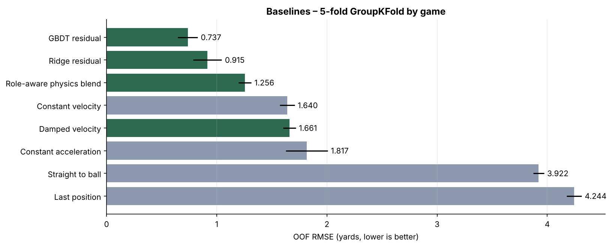

# GROUPXX_CENG313 · NFL Big Data Bowl 2026 – Prediction

> CENG313 term project. Rename the repository to `GROUP{ID}_CENG313` with the group number from the sign-up list.

## Team
| Name | Student ID | GitHub |
|---|---|---|
| _Name Surname_ | _xxxxxxxxx_ | _@username_ |
| _Name Surname_ | _xxxxxxxxx_ | _@username_ |
| _Name Surname_ | _xxxxxxxxx_ | _@username_ |

## Competition
**[NFL Big Data Bowl 2026 – Prediction](https://www.kaggle.com/competitions/nfl-big-data-bowl-2026-prediction)** (Kaggle, code competition).

When the quarterback releases a pass, predict the `(x, y)` position of selected players (the targeted receiver
and defenders in coverage) for every frame (10 Hz) until the ball arrives. Inputs are each player's
tracking data before the throw, the identity of the targeted receiver and the ball landing location.

**Metric:** RMSE over both coordinates, `sqrt( Σ[(x−x̂)² + (y−ŷ)²] / 2N )`, in yards.

## Dataset
| File | Content |
|---|---|
| `train/input_2023_w01–w18.csv` | Pre-pass tracking for all 22 players (x, y, speed, acceleration, direction, orientation, role, position, height, weight, …), the ball landing spot and `num_frames_output` |
| `train/output_2023_w01–w18.csv` | Post-pass `(x, y)` of the players to predict – the targets |
| `test.csv`, `test_input.csv` | Public example of the test format (2024 games); the hidden test set is served by the evaluation API |

2023 regular season, 18 weeks · 272 games · 14,108 plays · 562,936 frames to predict · ~830 MB.

## Repository layout
```
GROUPXX_CENG313/
├── README.md
├── assignment1_eda_baseline.ipynb   # Assignment 1: EDA + baselines (Colab, executed with outputs)
├── assignment2_solution.ipynb       # Assignment 2: proposed solution (December)
├── src/
│   ├── data.py      # loading, direction normalization, feature tables
│   ├── models.py    # baseline models with a common fit/predict interface
│   └── utils.py     # metric, game-grouped cross-validation, plotting
├── results/         # CV results tables
├── reports/figures/ # figures exported by the notebooks
├── kaggle/submission_baseline.ipynb # self-contained Kaggle notebook for a late submission
├── tools/                           # notebook builders
└── notebooks_src/                   # plain-text source of the notebooks
```

## How to run
**Google Colab (recommended)**
1. Open `assignment1_eda_baseline.ipynb` in Colab (*File → Open notebook → GitHub*).
2. Set `REPO_URL` in the first cell to this repository.
3. Accept the competition rules on Kaggle, then run all cells and upload `kaggle.json` when asked
   (Kaggle → Settings → API → *Create New Token*). The data is downloaded with the Kaggle API.

**Locally**
```bash
pip install -r requirements.txt
kaggle competitions download -c nfl-big-data-bowl-2026-prediction -p data
unzip data/nfl-big-data-bowl-2026-prediction.zip -d data/nfl-big-data-bowl-2026-prediction
jupyter notebook assignment1_eda_baseline.ipynb
```

## Approach (Assignment 1)
1. **EDA** – data quality checks, time in the air, pass depth, roles, kinematics at the throw and how
   players move while the ball is in the air.
2. **Normalization** – rotate plays so the offense always moves towards +x; convert NGS angles to velocity
   components (`vx = s·sin(dir)`, `vy = s·cos(dir)`).
3. **Feature table** – one row per (player, output frame) with the last pre-pass state, ball-landing
   geometry, player attributes and time features.
4. **Baselines** – evaluated with 5-fold `GroupKFold` by game (the test set consists of unseen games).

## Results – Assignment 1 baselines
Out-of-fold RMSE (yards) over all 562,936 training frames, 5-fold GroupKFold by `game_id`.

| # | Baseline | Idea | OOF RMSE | Fold std | Improvement vs constant velocity |
|---|---|---|---|---|---|
| B0 | Last position | player stops | 4.244 | 0.068 | -158.7% |
| B1 | Constant velocity | keep speed and direction | 1.640 | 0.067 | +0.0% |
| B2 | Constant acceleration | extrapolate the recent acceleration | 1.817 | 0.191 | -10.8% |
| B3 | Damped velocity | velocity decays as e^(−kt), k fitted | 1.661 | 0.057 | -1.3% |
| B4 | Straight to ball | run straight to the landing spot | 3.922 | 0.049 | -139.1% |
| B5 | Role-aware physics blend | per-role/phase blend of the two above (fitted weights) | 1.256 | 0.058 | +23.4% |
| B6 | Ridge residual | linear model of the constant-velocity residual | 0.915 | 0.131 | +44.2% |
| B7 | GBDT residual | gradient-boosted trees on the constant-velocity residual | **0.737** | 0.090 | +55.0% |



Main EDA findings
- Ball in the air 1.0 s on median (10 frames), long tail up to 9.4 s; air time ≈ linear in pass length (r = 0.95).
- Per play we predict the targeted receiver plus ~1/3 of the coverage defenders (≈3 players; 69% of rows are defenders).
- The targeted receiver closes from 5.3 yd to 1.2 yd (median) from the ball landing spot during the flight.
- Constant velocity is accurate for ~5 frames; afterwards defenders deviate more than receivers (they react to the throw).
- Passes longer than 2 s are ~20% of the rows but ~70% of the squared error of the best baseline.

## Progress log
| Date | Work |
|---|---|
| 2026-11-09 | Repository structure, reusable `src/` modules, EDA and 8 baselines (Assignment 1) |

## Kaggle submission history
| Date | Notebook / model | Public score | Private score | Note |
|---|---|---|---|---|
| – | `kaggle/submission_baseline.ipynb` (GBDT residual) | – | – | To be submitted as a late submission |

## Acknowledgements
Data: NFL Next Gen Stats via Kaggle – Lopez, Bliss, Blake, Yan, Plomecka, Howard (2025),
*NFL Big Data Bowl 2026 – Prediction*.
